# TRƯỜNG ĐẠI HỌC SƯ PHẠM KỸ THUẬT HƯNG YÊN
## KHOA CÔNG NGHỆ THÔNG TIN

# BÀI TẬP LỚN
## HỌC PHẦN: XỬ LÝ DỮ LIỆU LỚN (BIG DATA)

## ĐỀ TÀI: NGHIÊN CỨU VÀ XÂY DỰNG HỆ THỐNG PHÂN TÍCH DỮ LIỆU LỚN METADATA BÀI BÁO KHOA HỌC ARXIV TRÊN NỀN TẢNG HADOOP, SPARK, KAFKA VÀ HIVE

- **Sinh viên thực hiện:** LÊ DƯƠNG HIẾU
- **Mã sinh viên:** 12423011
- **Mã lớp:** 124231
- **Giảng viên hướng dẫn:** TS. NGUYỄN VĂN QUYẾT

---

## LỜI CẢM ƠN

Em xin chân thành cảm ơn thầy TS. NGUYỄN VĂN QUYẾT đã hướng dẫn và góp ý trong suốt quá trình thực hiện bài tập lớn.

## CHƯƠNG 1. GIỚI THIỆU BÀI TOÁN VÀ PHẠM VI DỮ LIỆU

### 1.1. Đặt vấn đề

arXiv là kho lưu trữ mở các bài báo khoa học với khối lượng metadata lớn và tăng liên tục. Bài tập lớn xây dựng hệ thống phân tích dữ liệu lớn gồm luồng batch (Spark → HDFS → Hive) và luồng sự kiện (Kafka → Spark Structured Streaming → HDFS), kết quả hiển thị trên dashboard Streamlit.

### 1.2. Mục tiêu

- Pipeline batch chạy lại được, có manifest và mã lần chạy.
- Chuẩn hóa năm nộp theo phiên bản v1, kiểm tra chéo với mã arXiv.
- Tính toán tăng trưởng, cơ cấu ngành, từ khóa, tác giả và chủ đề LDA.
- Kiểm định ngoại suy bằng holdout trước khi công bố dự báo.

### 1.3. Phạm vi dữ liệu

Nguồn: `VatsaDev/test_arxiv` tại revision `adef1f1e891574774660683f0f4548e50f5d551f`. Sử dụng 2 shard, tổng 543,0 MB.

| Shard | Tệp | Dung lượng | SHA-256 |
|---|---|---|---|
| 1 | `0000.parquet` | 270,2 MB | `99922809dfa2e73b…` |
| 2 | `0001.parquet` | 272,8 MB | `7d3f5349ddfb8edb…` |

Sau làm sạch: **704.329** bài, năm **2007–2016** (10 năm), **8** nhóm ngành; loại 0 dòng.

## CHƯƠNG 2. CƠ SỞ LÝ THUYẾT VÀ KIẾN TRÚC

Hệ thống dùng HDFS (lưu trữ), Spark (batch, streaming, MLlib), Kafka (sự kiện), Hive (external table) và Streamlit (dashboard). Hai luồng batch và streaming ghi vào hai thư mục HDFS riêng.

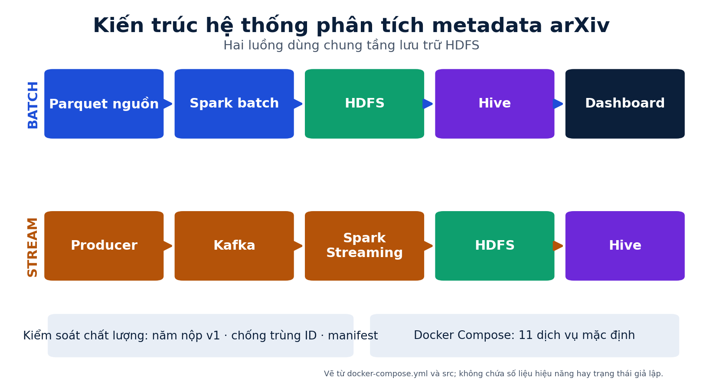

## CHƯƠNG 3. DỮ LIỆU VÀ PHƯƠNG PHÁP

Năm nộp lấy từ ngày tạo phiên bản v1, fallback theo mã arXiv, có xử lý riêng cho mã cũ trước 4/2007. Bản ghi thiếu trường bắt buộc hoặc năm không hợp lệ bị loại; mã trùng làm dừng pipeline.

Trong dữ liệu hiện tại có **2.323** bản ghi có năm v1 khác năm suy từ mã (thường do nộp cuối tháng 12 nhưng nhận mã tháng 1 năm sau).

Phân tích dùng window function của Spark cho tăng trưởng, tỷ trọng ngành, xếp hạng chuyên ngành. LDA dùng CountVectorizer + IDF trên tập chia xác định 80/20 theo mã bài; mỗi phía được lấy mẫu tất định (tối đa 200.000 bài huấn luyện, 50.000 bài kiểm định) để vừa tài nguyên máy.

## CHƯƠNG 4. KẾT QUẢ THỰC NGHIỆM

Lần chạy: `492bef9d-74a6-4f51-9298-a46f7b35b300` · Spark 3.5.3 · 464,7 giây phân tích.

### 4.1. Tổng quan

| Chỉ tiêu | Giá trị |
|---|---|
| Số shard | 2 |
| Dung lượng đầu vào | 543,0 MB |
| Bản ghi thô | 704.329 |
| Bản ghi sạch | 704.329 |
| Bản ghi bị loại | 0 |
| Khoảng năm | 2007–2016 |
| Nhóm ngành | 8 |
| Năm v1 khác năm mã | 2.323 |

### 4.2. Tăng trưởng theo năm

Trong các năm nội suy 2008–2015, số bài tăng từ 58.810 lên 104.991, tương đương 78,5%; tăng trưởng trung bình 12,3%/năm. Hai năm biên 2007 và 2016 có thể chưa đầy đủ.

| Năm | Số bài | YoY (%) |
|---|---|---|
| 2007 | 42.576 | — |
| 2008 | 58.810 | 38,1 |
| 2009 | 64.071 | 8,9 |
| 2010 | 70.288 | 9,7 |
| 2011 | 76.602 | 9,0 |
| 2012 | 84.374 | 10,1 |
| 2013 | 92.875 | 10,1 |
| 2014 | 97.589 | 5,1 |
| 2015 | 104.991 | 7,6 |
| 2016 | 12.153 | -88,4 |

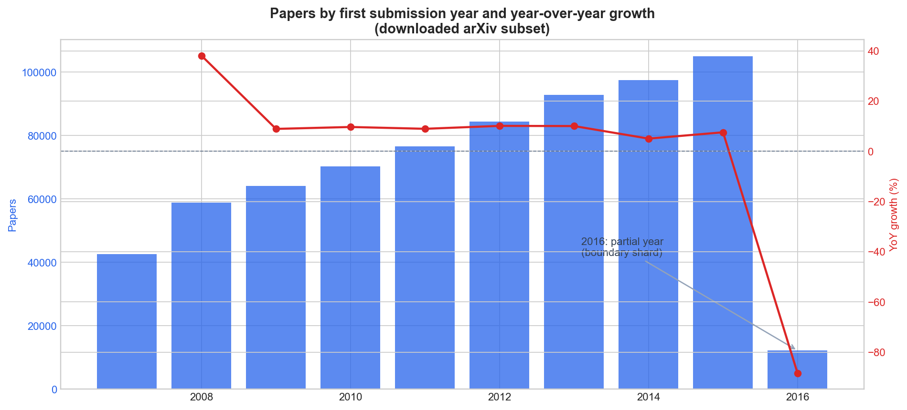

### 4.3. Cơ cấu nhóm ngành

| Nhóm | Số bài | Tỷ lệ (%) | Tác giả/bài | Abstract (ký tự) |
|---|---|---|---|---|
| physics | 433.867 | 61,6 | 5,52 | 936 |
| math | 167.901 | 23,8 | 1,92 | 628 |
| cs | 78.553 | 11,2 | 2,82 | 989 |
| stat | 10.546 | 1,5 | 2,70 | 1.008 |
| q-bio | 9.211 | 1,3 | 3,29 | 1.151 |
| q-fin | 4.237 | 0,6 | 2,26 | 884 |
| eess | 9 | 0,0 | 3,00 | 903 |
| econ | 5 | 0,0 | 1,80 | 1.342 |

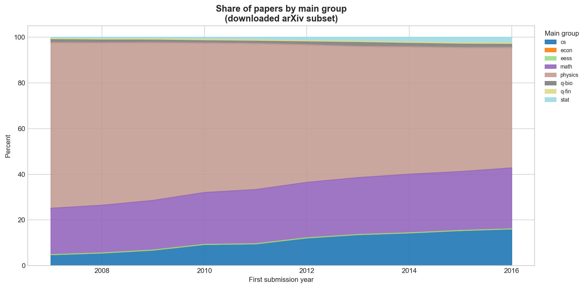

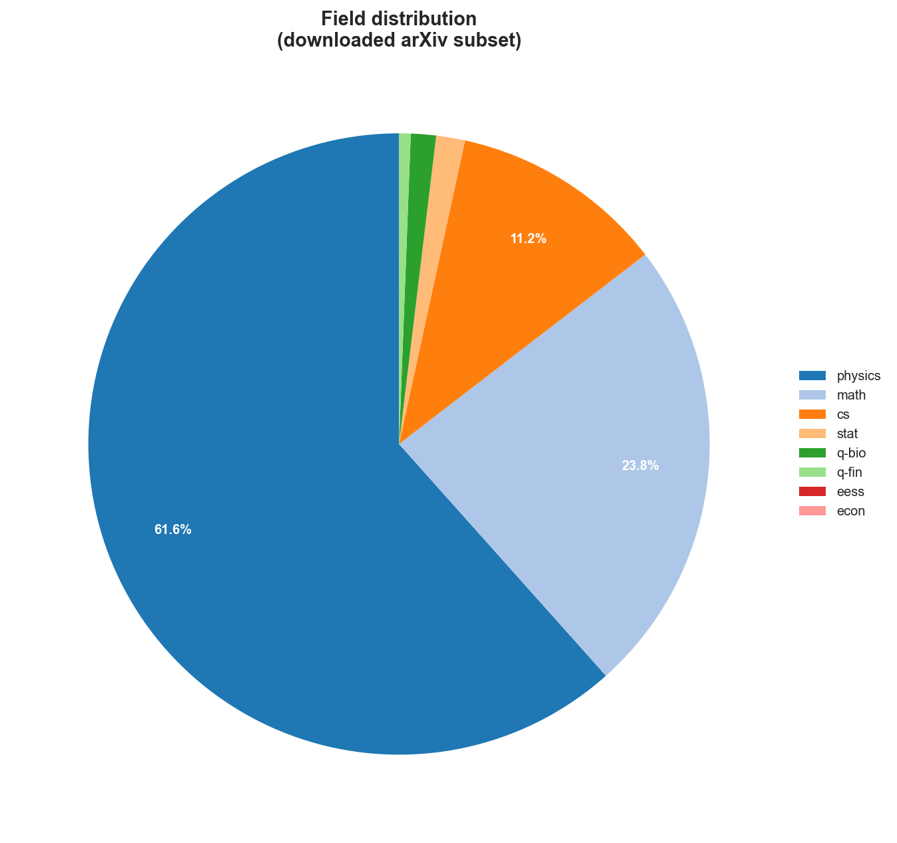

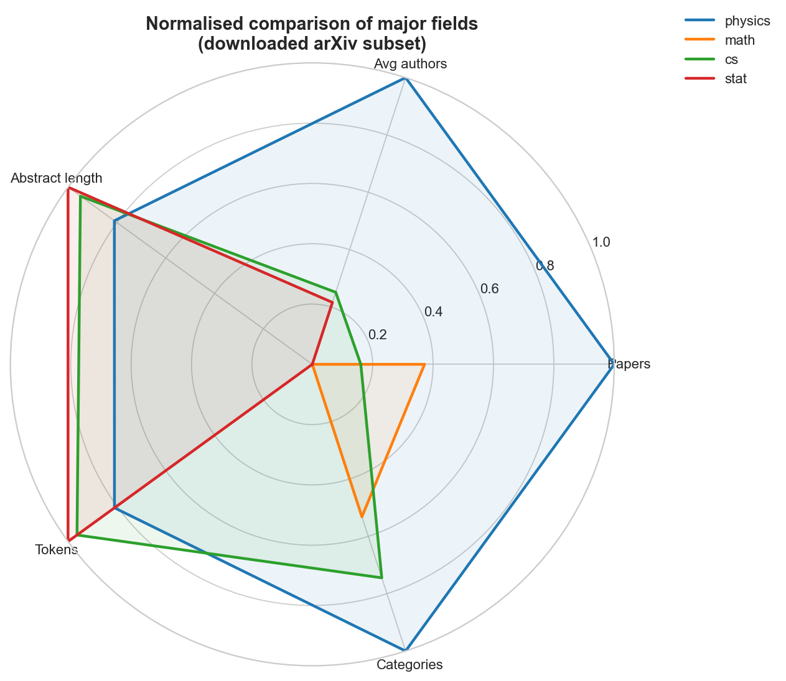

### 4.4. Chuyên ngành hàng đầu

Chuyên ngành lớn nhất: **hep-ph** với 39.691 bài.

| Hạng | Chuyên ngành | Số bài |
|---|---|---|
| 1 | hep-ph | 39.691 |
| 2 | quant-ph | 32.812 |
| 3 | hep-th | 30.459 |
| 4 | astro-ph.CO | 23.606 |
| 5 | cond-mat.mes-hall | 23.422 |
| 6 | astro-ph.SR | 20.290 |
| 7 | cond-mat.mtrl-sci | 19.308 |
| 8 | gr-qc | 19.287 |
| 9 | astro-ph | 17.812 |
| 10 | cond-mat.str-el | 16.194 |

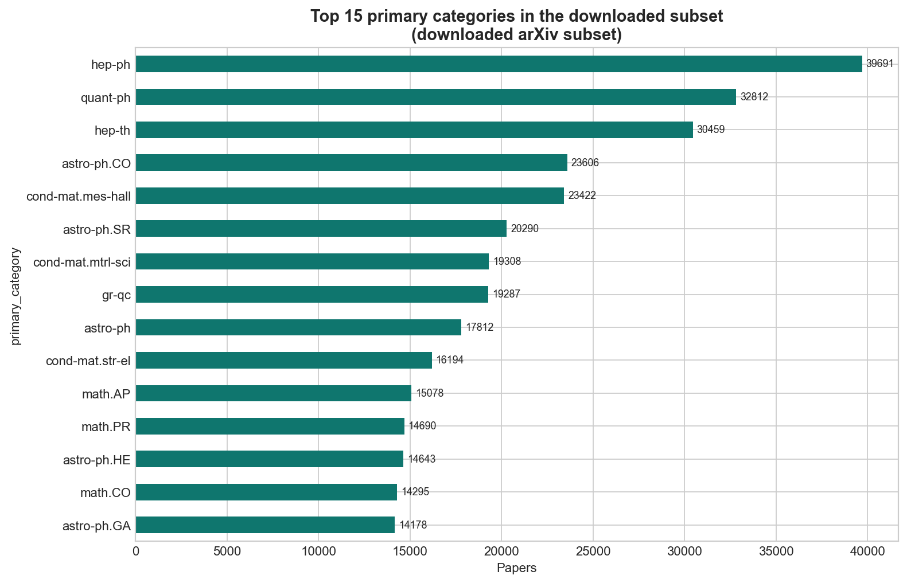

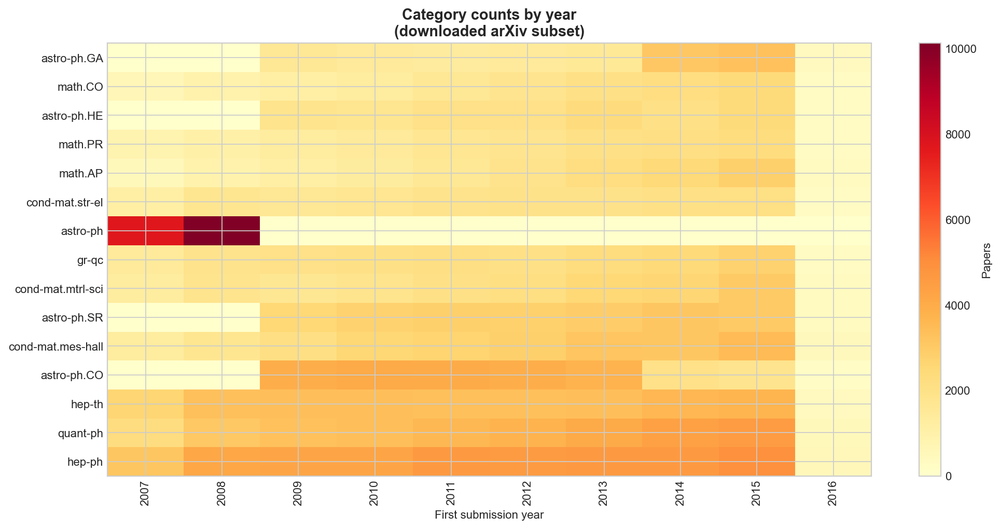

### 4.5. Từ khóa công nghệ

| Từ khóa | Số bài chứa (2015) | Trên 1.000 bài |
|---|---|---|
| transformer | 28 | 0,27 |
| attention | 1.468 | 13,98 |
| diffusion | 1.814 | 17,28 |
| quantum | 10.324 | 98,33 |
| neural | 1.472 | 14,02 |
| graph | 3.456 | 32,92 |

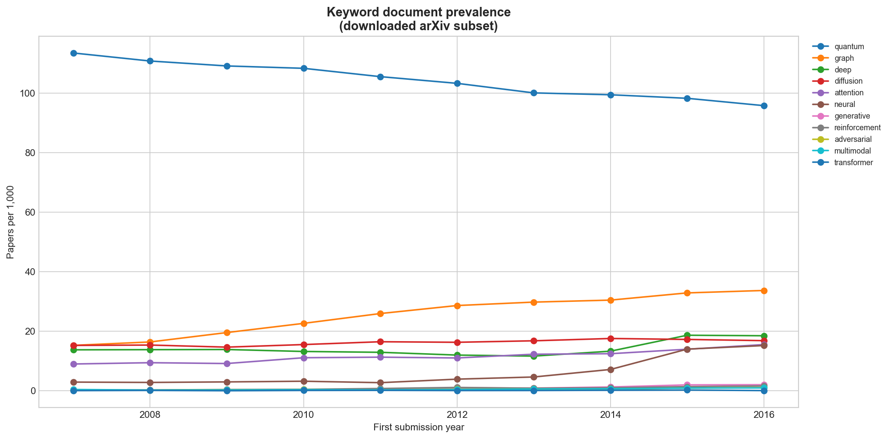

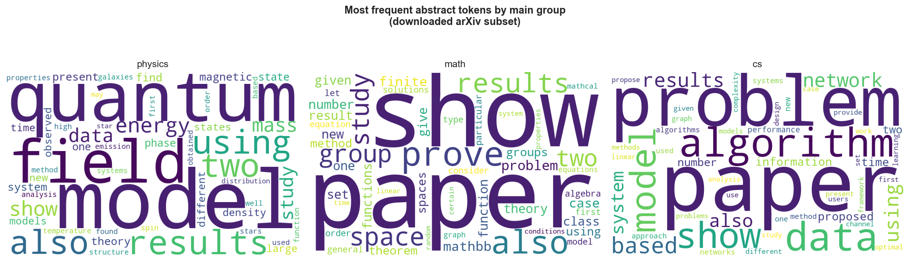

### 4.6. Tác giả và hợp tác

| Hạng | Tác giả | Số bài |
|---|---|---|
| 1 | Y. Zhang | 715 |
| 2 | Y. Li | 539 |
| 3 | L. Zhang | 482 |
| 4 | CMS Collaboration | 470 |
| 5 | ATLAS Collaboration | 457 |
| 6 | J. Wang | 451 |
| 7 | Y. Gao | 444 |
| 8 | S. Eidelman | 438 |
| 9 | O. Schneider | 430 |
| 10 | S. Ricciardi | 428 |
| 11 | J. Anderson | 417 |
| 12 | P. Krokovny | 413 |
| 13 | A. Bondar | 406 |
| 14 | M. Shapkin | 388 |
| 15 | T. Shears | 370 |

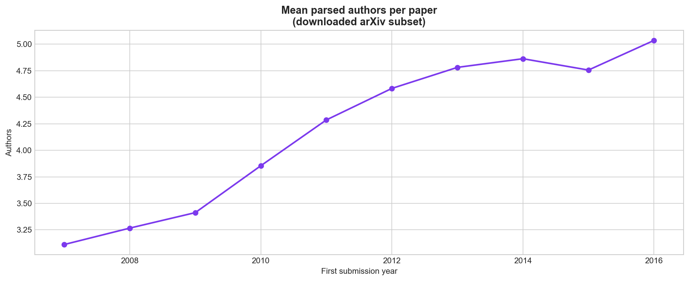

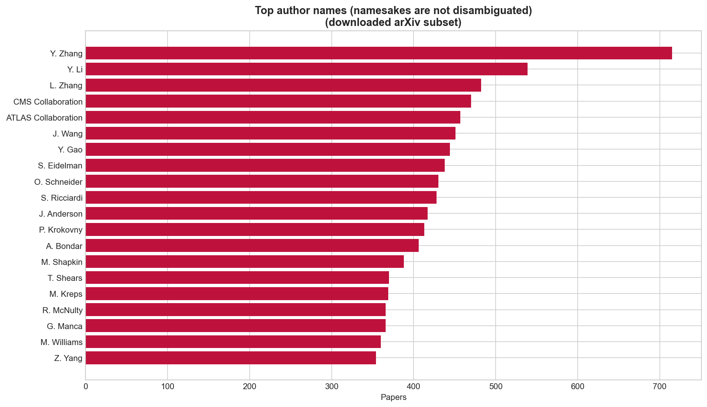

### 4.7. Mô hình chủ đề LDA

LDA 10 chủ đề, từ điển 10.000 từ, log-perplexity kiểm định 7,762.

| Chủ đề | Thuật ngữ đại diện | Tỷ lệ |
|---|---|---|
| T0 | model, higgs, channel, new, standard | 3,83% |
| T1 | model, data, paper, algorithm, problem | 18,58% |
| T2 | show, space, group, also, paper | 18,85% |
| T3 | quantum, phase, magnetic, state, states | 13,69% |
| T4 | stars, star, emission, observations, x-ray | 7,77% |
| T5 | equation, theory, model, equations, quantum | 13,99% |
| T6 | alpha, lambda, gamma, graph, delta | 5,51% |
| T7 | field, magnetic, model, matter, dark | 5,46% |
| T8 | galaxies, galaxy, mass, cluster, clusters | 3,72% |
| T9 | data, energy, results, model, using | 8,59% |

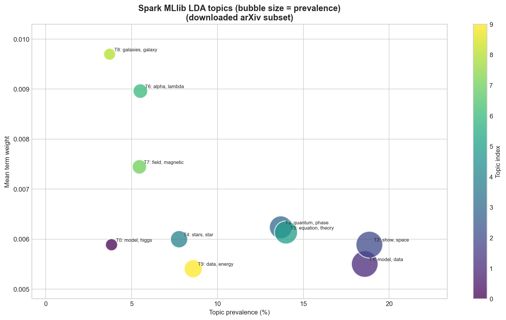

### 4.8. Kiểm định ngoại suy

| Từ khóa | MAE mô hình | MAE baseline | Kết luận |
|---|---|---|---|
| transformer | 0,069 | 0,091 | Chấp nhận |
| attention | 0,418 | 1,877 | Chấp nhận |
| diffusion | 0,237 | 0,910 | Chấp nhận |
| quantum | 0,813 | 4,029 | Chấp nhận |

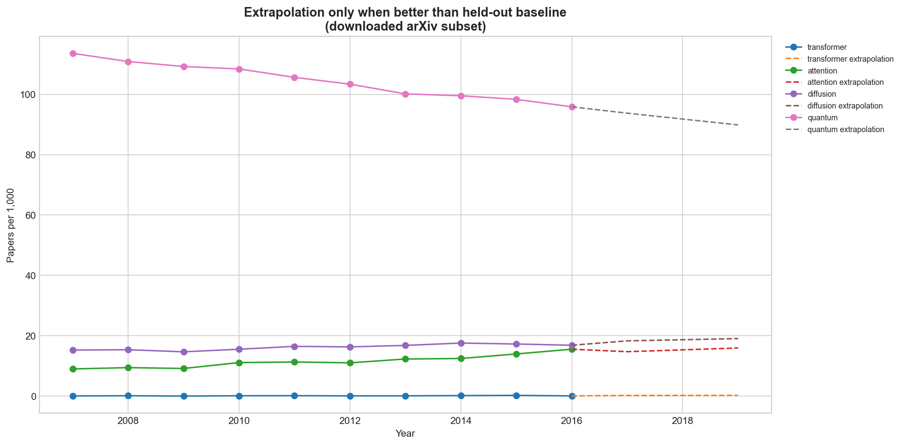

## CHƯƠNG 5. TRIỂN KHAI VÀ KIỂM CHỨNG

Cấu hình Docker Compose chạy 12 dịch vụ mặc định; Spark Worker thứ hai nằm trong profile `full` để giảm tải máy cá nhân. Pipeline được điều khiển bằng các lệnh trong phụ lục.

Thời gian phân tích từng bảng:

| Công đoạn | Giây |
|---|---|
| yearly_growth | 2,92 |
| field_trends | 3,30 |
| top_categories_yearly | 1,08 |
| hot_keyword_trends | 110,13 |
| field_metrics | 2,66 |
| group_terms | 9,68 |
| top_terms | 5,56 |
| top_authors | 8,25 |
| author_trends | 1,20 |

## CHƯƠNG 6. ĐÁNH GIÁ VÀ HẠN CHẾ

- Dữ liệu chỉ gồm các shard đã tải, không đại diện toàn bộ arXiv.
- Tên tác giả chưa phân giải thực thể.
- Danh sách từ khóa cố định, chưa phát hiện cụm từ mới.
- Hiệu năng phụ thuộc cấu hình máy, không phải benchmark chuẩn.

## KẾT LUẬN

Hệ thống xử lý 704.329 bài báo từ 543,0 MB dữ liệu, sinh đầy đủ bảng phân tích, 12 biểu đồ và kết quả kiểm định ngoại suy có thể tái lập.

## PHỤ LỤC: CÁCH CHẠY LẠI

```bash
python src/batch_pipeline.py all
python src/visualization.py
python src/batch_pipeline.py sync-hdfs
python src/hive_client.py
python scripts/build_data_mining_style_report.py
python scripts/build_presentation_slides.py
```
